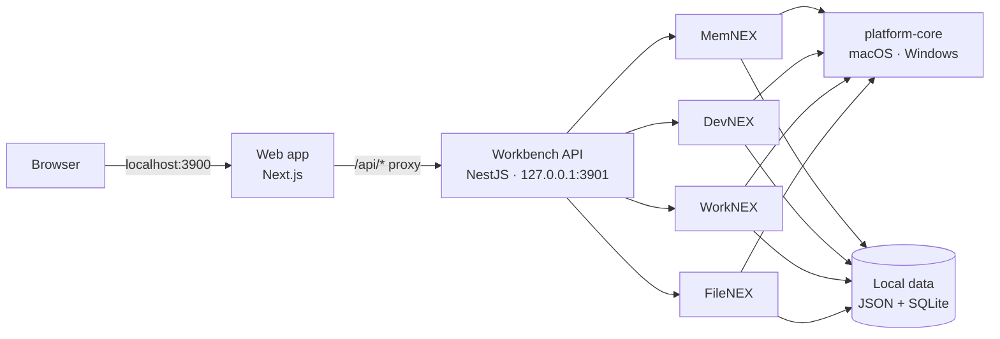

<div align="center">

# NEX Workbench

### Local tools. Local data. Local control.

Four tools for developers in one local app. They watch your machine, your projects, your work and your files.<br>
Everything runs on your computer. There's no cloud, no account and no telemetry.

[](LICENSE)


[**Get started**](#-get-started) · [**What's inside**](#-whats-inside) · [**Privacy**](#-privacy-and-safety) · [**ภาษาไทย**](#-ภาษาไทย) · [**Development**](#-development)

</div>

---

## ✨ What's inside

<table>
<tr>
<td width="50%" valign="top">

### 🧠 MemNEX
**Local System Intelligence**<br>
<sub>Smart Cleanup. Not Blind Cleanup.</sub>

- Monitors RAM, CPU and swap, and groups processes by app.
- Gives a plain-language diagnosis of what's slowing you down.
- Lets you mark protected apps that cleanup always skips.
- Cleanup shows a preview first, and before/after numbers afterwards.

</td>
<td width="50%" valign="top">

### 🛠️ DevNEX
**Local Developer Control Center**<br>
<sub>Know what's running. Fix what's broken.</sub>

- Shows each project's services and ports, plus CPU and RAM per project.
- Finds port conflicts and tells you who owns each port.
- Checks `.env` files and masks their values.
- Adds Git, Docker and runtime context, and suggests a fix for each issue.

</td>
</tr>
<tr>
<td width="50%" valign="top">

### ⏱️ WorkNEX
**Work Continuity Intelligence**<br>
<sub>Pick up where you left off.</sub>

- Remembers each work context across editor, terminal and browser.
- **Resume** reopens a context and previews exactly what will open first.
- Timeline, save points and *Where was I?*
- Tracks nothing until you add apps to its allowlist.

</td>
<td width="50%" valign="top">

### 📁 FileNEX
**Local File Intelligence**<br>
<sub>Find the work, not the filename.</sub>

- Finds files by project, context, type and date.
- Shows versions and duplicates.
- **Storage Intelligence** shows where your disk space went, including dependencies and build output per repo.
- Its suggested cleanup plan only previews. **It never deletes.**

</td>
</tr>
</table>

Everything lives at one address: **http://localhost:3900**

```text
http://localhost:3900
├── /memnex    MemNEX   — system
├── /devnex    DevNEX   — projects & services
├── /worknex   WorkNEX  — work contexts
└── /filenex   FileNEX  — files & storage
```

---

## 🚀 Get started

> **You need [Node.js](https://nodejs.org) 22.13 or newer** (the LTS installer is fine). It runs on macOS and Windows.

**1 · Get the code**

```bash
git clone https://github.com/pleumjj/NEXWorkbench.git
cd NEXWorkbench
```

<sub>Or use **Code › Download ZIP** on GitHub and unzip it.</sub>

**2 · Install and start it with one command**

```bash
npm run setup
```

This command:

1. checks your Node version;
2. installs dependencies;
3. builds the app and starts it;
4. opens **http://localhost:3900** in your browser.

The first run takes a few minutes. Keep the terminal open while you use it, and press **Ctrl + C** to stop.

<table>
<tr><th align="left">I want to…</th><th align="left">Do this</th></tr>
<tr><td>Start without a terminal</td><td><b>macOS:</b> double-click <code>Start NEX Workbench.command</code>. The first time, right-click it and choose <b>Open</b>.<br><b>Windows:</b> double-click <code>Start NEX Workbench.cmd</code></td></tr>
<tr><td>Start it again later</td><td><code>npm run app</code>, or the double-click file. If it's already running, this just opens the browser.</td></tr>
<tr><td>Update to the latest version</td><td><code>git pull</code> then <code>npm run setup</code>. Your settings and data are kept.</td></tr>
<tr><td>Switch to Thai</td><td><b>Settings › Language › ไทย</b>. By default it follows your system language.</td></tr>
</table>

**First steps after you open it**

- **FileNEX** reads nothing until you add a folder in FileNEX › Settings.
- **WorkNEX** tracks nothing until you add apps to its allowlist.
- On macOS, reading window titles needs **Accessibility** permission. WorkNEX asks when you turn titles on.

---

## 🔒 Privacy and safety

| | |
|---|---|
| 🏠 **Local only** | Both servers listen on `127.0.0.1`. They aren't reachable from your network or the internet. |
| 📵 **No telemetry** | No analytics. Next.js telemetry is turned off. The fonts are bundled, so the app itself never calls the internet. |
| ✋ **Nothing automatic** | Nothing is closed or stopped without your confirmation. Force close exists only in MemNEX, and only after you confirm. |
| 🗑️ **No deleting** | FileNEX never deletes, moves or renames files. Cleanup shows the exact paths and leaves the decision to you. |
| 📂 **Permission first** | FileNEX only reads folders you add. Registering a project in DevNEX doesn't give FileNEX access to it. |
| 🔑 **Secrets stay masked** | `.env` values are masked before they leave the API, and they're never stored or logged. |
| 🛡️ **System is off-limits** | The API refuses to touch operating-system processes, NEX itself and your protected apps. The UI hides them, and the API enforces it too. |

Your data is a set of small JSON files plus one SQLite index, stored on your computer and never committed to Git. See [Local data](#local-data).

---

## 🇹🇭 ภาษาไทย

NEX Workbench คือชุดเครื่องมือสำหรับนักพัฒนา 4 ตัวในแอปเดียว ทำงานบนเครื่องของคุณทั้งหมด ไม่ส่งข้อมูลขึ้น cloud ไม่ต้องสมัครบัญชี และไม่มี telemetry

| โมดูล | ทำอะไร |
|---|---|
| 🧠 **MemNEX** | ดู RAM / CPU / swap, บอกว่าเครื่องช้าเพราะอะไร, เคลียร์แบบเห็นตัวอย่างก่อนทุกครั้ง |
| 🛠️ **DevNEX** | ดูโปรเจกต์ บริการ และพอร์ตที่รันอยู่, หาพอร์ตชนกัน, ตรวจ `.env` |
| ⏱️ **WorkNEX** | จำว่าทำงานอะไรค้างไว้ แล้วเปิดกลับมาทำต่อได้ (Resume) |
| 📁 **FileNEX** | ค้นไฟล์ตามงาน, ดูว่าพื้นที่ดิสก์หายไปไหน, แนะนำสิ่งที่ลบได้ (แต่ไม่ลบให้เอง) |

**ติดตั้ง:** ต้องมี [Node.js](https://nodejs.org) 22.13 ขึ้นไป จากนั้นรัน

```bash
git clone https://github.com/pleumjj/NEXWorkbench.git
cd NEXWorkbench
npm run setup
```

ระบบจะติดตั้งและ build ให้ แล้วเปิด http://localhost:3900 ให้อัตโนมัติ ครั้งต่อไปใช้ `npm run app` หรือดับเบิลคลิก `Start NEX Workbench.command` บน macOS ก็ได้ ส่วนการเปลี่ยนภาษาอยู่ที่ **Settings › Language** ค่าเริ่มต้นจะใช้ภาษาตามระบบปฏิบัติการ

---

## 📖 Module guides

<details>
<summary><b>MemNEX</b>: system health and Smart Cleanup</summary>

<br>

- Monitors RAM, CPU and swap, and groups processes into apps.
- Gives a deterministic diagnosis and lets you mark protected apps.
- Smart Cleanup shows a preview first, then before/after measurements.
- It tries a graceful quit first. Force close happens only after you explicitly confirm.

→ [docs/memnex/README.md](docs/memnex/README.md)
</details>

<details>
<summary><b>DevNEX</b>: projects, services and ports</summary>

<br>

DevNEX shows each project's services and ports, who owns each port, and any conflicts. It also shows:

- CPU and RAM per project;
- live logs for services it starts;
- `.env` checks with masked values;
- runtime, Git and Docker context;
- issues with a recommended action for each.

**DevNEX finds projects in three ways:**

1. **Automatically.** Any dev server listening on a port is traced back to its project folder.
2. **Add a project.** Use DevNEX › Projects › *Add a project folder*.
3. **Add a folder of projects.** Use DevNEX › Settings › *Project folders*. DevNEX looks two levels deep and never scans the whole disk.

**`devnex.config.json` (optional).** Put this file in a project's root to name the project and declare its services exactly. Without it, DevNEX uses the `dev*` scripts in `package.json` and any compose files.

```json
{
  "name": "SmartFlowNEX",
  "services": [
    { "name": "frontend", "type": "frontend", "command": "npm run dev:web", "port": 3000 },
    { "name": "backend", "type": "backend", "command": "npm run dev:api", "port": 4000 }
  ]
}
```

`type` must be one of `frontend`, `backend`, `database`, `cache`, `worker`, `queue`, `container` or `app`. Commands are only ever read from this file or from `package.json`. The browser can't send commands.

→ [docs/devnex/README.md](docs/devnex/README.md)
</details>

<details>
<summary><b>WorkNEX</b>: work contexts and Resume</summary>

<br>

A work context is one piece of work as it shows up across your apps: a project in your editor, terminal and localhost browser tabs, or a family of related documents. WorkNEX remembers these so you can see where you stopped. **Resume** reopens a context and first shows a preview of exactly what will open. WorkNEX also has a timeline, save points, *Where was I?* and descriptive insights.

**No consent, no tracking.** WorkNEX tracks nothing until you add apps to its allowlist (WorkNEX › Settings › Tracked applications).

- A newly added app starts at *Presence* level: WorkNEX records only its name and time.
- Window titles, files and URLs are separate opt-ins for each app.
- Apps you haven't added leave no trace.
- You can pause tracking at any time.
- Raw activity is never written to disk, and there are no productivity scores.

→ [docs/worknex/README.md](docs/worknex/README.md)
</details>

<details>
<summary><b>FileNEX</b>: file search and Storage Intelligence</summary>

<br>

**Search.** You can search your files by:

- project;
- WorkNEX context;
- type;
- date.

Each result has *Why this result?* and a list of related files. FileNEX also groups versions of a file and hints which one is *likely latest*, and finds exact and possible duplicates. It reads metadata only, keeps its index in a local SQLite file, and indexes a folder only after you add it.

**Storage Intelligence** (`/filenex/storage`):

- **Disk status:** used and free space, with a status of Healthy, Attention, Low or Critical.
- **Where the space went:** inside the folders you approved, plus a list of large files.
- **What grew?** and a simple forecast, based on local snapshots.
- **Developer Storage:** repositories ranked by size and broken down into source, dependencies, build output, cache, logs, Git and Docker. Git worktrees are grouped under their repository.
- **Cleanup Review:** every candidate is marked Safe to review, Review carefully or Protected. A **Suggested plan** explains what to look at first and why, and **Export for Claude** saves the plan as a report.

→ [docs/filenex/README.md](docs/filenex/README.md)
</details>

<details>
<summary><b>Language</b>: English and ไทย</summary>

<br>

To change the language, open **Workbench › Settings › Language**. By default it follows your operating system. Dates always use the Gregorian calendar. Reports exported for Claude and timesheet CSV files are always in English.

→ [docs/i18n/README.md](docs/i18n/README.md)
</details>

---

## 🧑‍💻 Development

```bash
npm install
npm run dev     # API + web app + TypeScript watcher, with hot reload
```

> `npm run dev` and `npm run setup`/`npm run app` share the web build folder. Stop one before you start the other.

| Command | What it does |
|---|---|
| `npm run setup` | **For users:** checks Node, installs, builds, starts and opens the browser |
| `npm run app` | **For users:** starts the built app, building first if needed, and opens the browser |
| `npm run dev` | Builds the shared packages, then runs the API, the web app and a TypeScript watcher |
| `npm test` | Compiles and runs every unit test (`node --test`) |
| `npm run typecheck` | Type-checks everything. `npm run lint` does the same. |
| `npm run build` | Production build of the packages, API and web app |
| `npm start` | Runs the production build |
| `npm run clean` | Removes build output (`dist`, `.next`) but never touches local data |

<details>
<summary><b>Architecture</b></summary>

<br>



```text
apps/
  workbench-web/      Next.js shell: Home, Settings, command palette, module screens
  workbench-api/      NestJS controllers (wiring only)
modules/
  memnex/             Health, recommendations, protection, cleanup
  devnex/             Projects, services, ports, env, runtime, git, docker, health
  worknex/            Activity, context, session, resume, privacy engines
  filenex/            Privacy, index, search, relationships, versions, duplicates, storage
packages/
  shared/             Product-agnostic types + the module contract
  platform-core/      OS adapters (macOS, Windows), the only place that branches on the OS
  process-core/       Process inventory, grouping, classification, graceful control
  system-core/        RAM / CPU / swap / host
  telemetry-core/     In-process event bus + Server-Sent Events
  config/             Ports, loopback guard, small JSON stores
  logger/             Leveled logger + bounded ring buffer
  i18n/               Translation runtime and the Thai dictionary
  ui/                 Design system (tokens, components)
```

→ [docs/architecture/ARCHITECTURE.md](docs/architecture/ARCHITECTURE.md)
</details>

<details>
<summary><b>Ports and network</b></summary>

<br>

| Port | Process | Reachable from |
|---|---|---|
| **3900** | Web app (Next.js): the user-facing UI | `127.0.0.1` only |
| 3901 | Workbench API (NestJS): internal, proxied under `/api/*` | `127.0.0.1` only |

- The API rejects requests whose `Host` isn't a loopback address, which blocks DNS rebinding. It also rejects requests whose `Origin` isn't the Workbench, which blocks cross-site requests.
- You can override the ports and hosts with `NEX_WEB_PORT`, `NEX_API_PORT`, `NEX_WEB_HOST` and `NEX_API_HOST`. Only do this if you know you need to.
</details>

<details id="local-data">
<summary><b>Local data</b></summary>

<br>

Your data is stored next to the API, in `apps/workbench-api/`. These folders are ignored by Git and kept when you update.

| Folder | Contents |
|---|---|
| `.nex/` | Workbench preferences: enabled modules, refresh, language |
| `.memnex/` | Protected apps, learned preferences, app-usage timestamps, icon cache |
| `.devnex/` | Registered projects and project folders |
| `.worknex/` | WorkNEX allowlist and settings, derived work contexts (kept for a limited time), save points |
| `.filenex/` | Indexed locations, settings, and `index.sqlite`: file metadata, collections, storage snapshots, storage analyses |

Logs, raw WorkNEX activity, recent activity and cleanup history are kept only in memory, so they're gone when NEX stops.
</details>

<details>
<summary><b>Known limitations</b></summary>

<br>

- **Windows:** the adapter is implemented but hasn't been tested on a real Windows machine yet. Working-directory lookup isn't available there, so DevNEX links processes to projects by their command line only.
- DevNEX shows logs only for services it started itself. It can't attach to a terminal that's already running.
- DevNEX reads Docker status but doesn't start or stop containers.
- Runtime checks cover Node.js, npm, pnpm and yarn.
- Recent Activity covers only the current session.
- WorkNEX observes only the front window, and only for apps you added.
- Starting a project starts each of its services, but in no particular order: dependencies between services aren't handled yet.
</details>

---

## 📄 License

[MIT](LICENSE) © 2026 pleumjj

The bundled IBM Plex Sans Thai font is licensed under the [SIL Open Font License](apps/workbench-web/app/fonts/IBMPlexSansThai-OFL.txt).

<div align="center"><sub>Built for developers who want to understand their own machine, without sending it anywhere.</sub></div>
